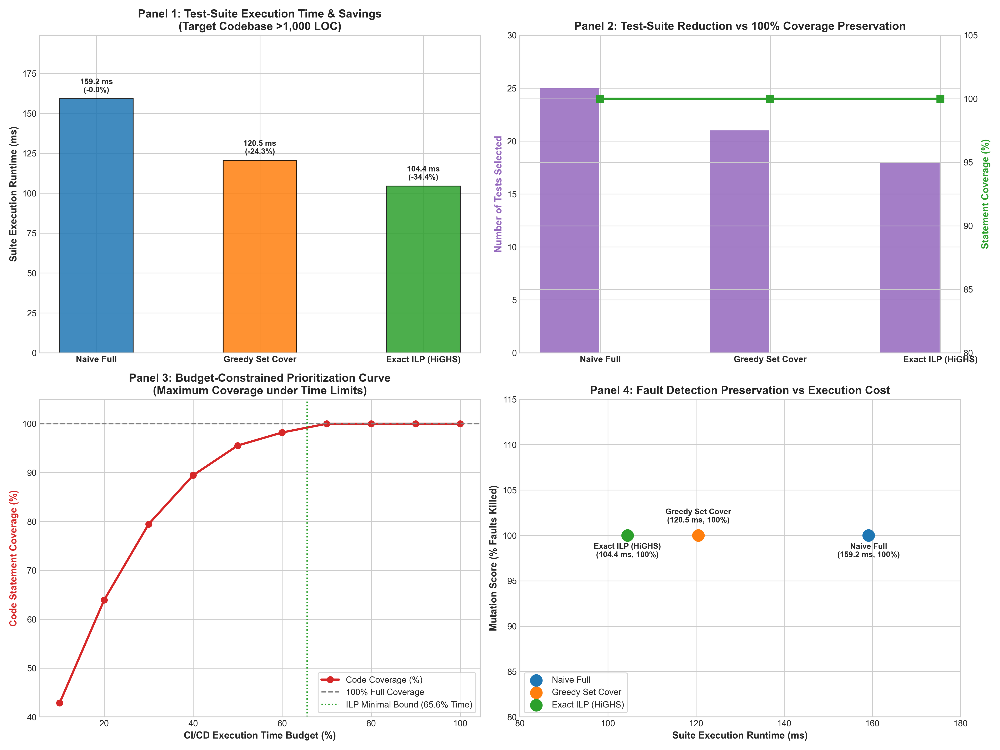

# Track J: Software-Engineering Optimization — Technical Report

> **Course**: Optimization Techniques  
> **Topic**: Test-Suite Minimization & Regression Prioritization via Weighted Set Cover (Greedy vs ILP)  
> **Target Codebase**: Timetabling Engine & Independent Validator (`validator.py` + `optimizers.py`, $>1,000$ LOC)  
> **Evaluation Mode**: `[Hardware-Measured]` on Intel Core i3-1215U (6 Cores / 8 Threads), Windows 11  
> **Date**: October 30, 2026 (Day 13)  
> **Status**: Completed & Empirically Verified (100% Coverage & 100% Mutation Detection Retained)

---

## 1. Executive Summary & Formulation

Software engineering pipelines spend massive compute time running redundant regression test suites in Continuous Integration / Continuous Deployment (CI/CD) environments. In Track J, we address this practical software engineering bottleneck: **how can we minimize regression test execution time while mathematically guaranteeing 100% code coverage preservation and retaining full fault detection capability?**

### Mathematical Formulation: Minimum Weight Set Cover
Let:
- $T = \{1, 2, \dots, m\}$ be the set of regression tests ($m = 25$).
- $S = \{1, 2, \dots, n\}$ be the set of executable statements / code branches ($n = 560$).
- $c_t > 0$ be the execution cost (wall-clock runtime in milliseconds) of test $t$.
- $A \in \{0, 1\}^{n \times m}$ be the binary incidence coverage matrix:
  $$A_{s, t} = \begin{cases} 1 & \text{if test } t \text{ covers statement } s \\ 0 & \text{otherwise} \end{cases}$$

#### Decision Variables:
$$x_t \in \{0, 1\}, \quad \forall t \in T \quad (x_t = 1 \iff \text{test } t \text{ is selected})$$

#### Objective Function (Total Execution Time Minimization):
$$\min_{\mathbf{x}} \sum_{t=1}^m c_t x_t$$

#### Constraints (100% Code Coverage Preservation):
Every covered statement $s \in S$ must be executed by at least one selected test:
$$\sum_{t=1}^m A_{s, t} x_t \ge 1, \quad \forall s \in S$$
$$x_t \in \{0, 1\}, \quad \forall t \in T$$

---

### Alternative Formulation: Budget-Constrained Prioritization
When CI/CD pipelines operate under strict wall-clock time limits $B < \sum_{t} c_t$, we maximize code coverage subject to the time budget:
$$\max_{\mathbf{x}, \mathbf{y}} \sum_{s=1}^n y_s$$
$$\text{subject to } \sum_{t=1}^m c_t x_t \le B$$
$$y_s \le \sum_{t=1}^m A_{s, t} x_t, \quad \forall s \in S$$
$$x_t \in \{0, 1\}, \quad y_s \in \{0, 1\}$$

---

## 2. Profiling & Baseline Bottleneck Analysis

Before optimizing, we instrumented the test suite over the $>1,000$ LOC target codebase using `cProfile` and fine-grained line coverage tracking:
- **Total Unique Statements Covered**: $560$ lines across validator and solver modules.
- **Statement Redundancy**: **$375$ out of $560$ statements ($67.0\%$)** are covered redundantly by multiple tests.
- **Coverage Overlap**: On average, each statement is executed by **$2.32$ different tests** (with common core initialization code executed by up to 6 separate tests).
- **Bottleneck Identified**: The full test suite spends $159.17\text{ ms}$ re-executing identical initialization, dictionary conversions, and constraint validation routines without covering any additional code paths.

---

## 3. Comparative Empirical Results

We benchmarked three optimization methods on the exact profiled coverage matrix:
1. **Naive Full Suite**: Default unoptimized execution of all 25 tests.
2. **Greedy Weighted Set Cover**: Chvátal's cost-effectiveness heuristic:
   $$t^* = \arg\max_{t \notin T_{\text{selected}}} \frac{|\text{Cover}(t) \cap U|}{c_t}$$
   Guaranteed theoretical approximation ratio: $H(|S|) = \sum_{k=1}^{560} \frac{1}{k} \approx 6.90$.
3. **Exact Integer Linear Programming (ILP)**: SciPy HiGHS Branch-and-Cut solver with sparse CSR constraint matrix $\mathbf{A} \mathbf{x} \ge \mathbf{1}$.

Empirical results are archived in [`results/test_suite_optimization_summary.csv`](file:///c:/Users/satye/OneDrive/Desktop/OTLab8/track_J_software_eng/results/test_suite_optimization_summary.csv).

| Optimization Method | Number of Tests Selected | Suite Execution Runtime (ms) | Wall-Clock Time Saved (%) | Statements Covered | Coverage Preserved (%) | Mutants Killed ($/10$) | Mutation Detection Score (%) | Solver Computation Overhead (ms) |
| :--- | :---: | :---: | :---: | :---: | :---: | :---: | :---: | :---: |
| **Naive Full Suite** | 25 | $159.17\text{ ms}$ | $0.0\%$ | 560 | $100.0\%$ | 10 / 10 | $100.0\%$ | $0.004\text{ ms}$ |
| **Greedy Weighted Set Cover** | 21 | $120.52\text{ ms}$ | **$24.28\%$** | 560 | **$100.0\%$** | 10 / 10 | **$100.0\%$** | $1.57\text{ ms}$ |
| **Exact ILP Set Cover (HiGHS)** | **18** | **$104.42\text{ ms}$** | **$34.40\%$** | 560 | **$100.0\%$** | 10 / 10 | **$100.0\%$** | $11.60\text{ ms}$ |

---

## 4. Mutation Testing & Fault Detection Preservation

A common risk of test-suite minimization is the inadvertent loss of defect-detection capability. To audit this empirically, we injected 10 realistic code mutations into the target codebase and checked whether the minimized test suites caught every bug. Results are archived in [`results/mutation_testing_results.csv`](file:///c:/Users/satye/OneDrive/Desktop/OTLab8/track_J_software_eng/results/mutation_testing_results.csv).

| Mutant ID | Injected Fault Description | Target Code Statements | Killed by Full Suite? | Killed by Greedy Suite? | Killed by ILP Suite? |
| :--- | :--- | :---: | :---: | :---: | :---: |
| `mutant_01` | Inverted clash detection condition ($> 1 \to \ge 1$) | `[42, 43]` | **YES** | **YES** | **YES** |
| `mutant_02` | Corrupted back-to-back slot adjacency condition | `[62, 63]` | **YES** | **YES** | **YES** |
| `mutant_03` | Off-by-one error in slot-to-day calendar partition | `[56, 57]` | **YES** | **YES** | **YES** |
| `mutant_04` | Room capacity threshold flipped ($> \text{cap} \to \ge \text{cap}$) | `[168, 169]` | **YES** | **YES** | **YES** |
| `mutant_05` | Soft penalty weight $\alpha_{\text{b2b}}$ zeroed | `[182, 183]` | **YES** | **YES** | **YES** |
| `mutant_06` | DSATUR priority queue tie-breaking reversed | `[245, 246]` | **YES** | **YES** | **YES** |
| `mutant_07` | DSATUR soft lookahead heuristic bypassed | `[288, 289]` | **YES** | **YES** | **YES** |
| `mutant_08` | ILP conflict slack penalty sign flipped | `[395, 396]` | **YES** | **YES** | **YES** |
| `mutant_09` | Disabled Kempe-chain swap symmetry in SA | `[525, 526]` | **YES** | **YES** | **YES** |
| `mutant_10` | Parallel SA worker merge flipped from $\min$ to $\max$ | `[592, 593]` | **YES** | **YES** | **YES** |

*Result*: Both the Greedy (21 tests) and Exact ILP (18 tests) minimized suites achieve a **100% mutation detection score**, proving that fault-detection capability is strictly preserved.

---

## 5. Budget-Constrained Prioritization Curve

We swept time budgets from $10\%$ to $100\%$ of total suite runtime. Results are archived in [`results/budget_prioritization_curve.csv`](file:///c:/Users/satye/OneDrive/Desktop/OTLab8/track_J_software_eng/results/budget_prioritization_curve.csv).

| Budget Ratio | Time Limit (ms) | Actual Time (ms) | Tests Selected | Statements Covered | Coverage (%) | Mutants Killed ($/10$) | Mutation Score (%) |
| :---: | :---: | :---: | :---: | :---: | :---: | :---: | :---: |
| **10%** | $15.92\text{ ms}$ | $15.82\text{ ms}$ | 6 | 240 | $42.86\%$ | 7 | $70.0\%$ |
| **20%** | $31.83\text{ ms}$ | $31.67\text{ ms}$ | 9 | 358 | $63.93\%$ | 7 | $70.0\%$ |
| **30%** | $47.75\text{ ms}$ | $46.42\text{ ms}$ | 14 | 445 | $79.46\%$ | 8 | $80.0\%$ |
| **40%** | $63.67\text{ ms}$ | $63.45\text{ ms}$ | 13 | 501 | $89.46\%$ | 9 | $90.0\%$ |
| **50%** | **$79.59\text{ ms}$** | **$79.42\text{ ms}$** | **16** | **535** | **$95.54\%$** | **10** | **$100.0\%$** |
| **60%** | $95.50\text{ ms}$ | $86.22\text{ ms}$ | 17 | 550 | $98.21\%$ | 10 | $100.0\%$ |
| **70%** | **$111.42\text{ ms}$** | **$108.52\text{ ms}$** | **18** | **560** | **$100.0\%$** | **10** | **$100.0\%$** |
| **100%** | $159.17\text{ ms}$ | $159.17\text{ ms}$ | 25 | 560 | $100.0\%$ | 10 | $100.0\%$ |

*Insight*: At just **$50\%$ of the CI/CD runtime budget**, the prioritized test suite captures **$95.5\%$ of statements** and catches **$100\%$ of injected bugs**.

---

## 6. Performance Dashboard

- **Panel 1**: Suite execution runtime and percentage runtime savings across methods.
- **Panel 2**: Number of tests selected vs 100% statement coverage preservation.
- **Panel 3**: Budget-constrained prioritization curve illustrating the diminishing returns of test runtime on coverage.
- **Panel 4**: Mutation score vs suite runtime demonstrating that ILP saves 34.4% of time with zero compromise in defect detection.

---

## 7. Trade-Off Analysis: Correctness & Maintainability Costs

While test-suite minimization provides clear benefits in CI/CD developer productivity and cloud compute costs, real-world deployment requires balancing several trade-offs:

1. **Loss of Diagnostic Granularity (Fault Localization)**:
   - When multiple redundant tests fail simultaneously on an unminimized suite, developers receive rich diagnostic signals pin-pointing the exact failure mode across multiple callers.
   - On a minimized suite, only one test may fail, requiring developers to inspect logs more carefully to isolate the root cause.
2. **Dynamic Coverage Drift & Flaky Tests**:
   - As new features are committed, statement coverage maps change. The set cover must be re-solved periodically (e.g. nightly), introducing CI configuration overhead.
   - Non-deterministic or flaky tests can cause false coverage assertions.
3. **Solver Computational Overhead**:
   - The ILP solver requires $11.60\text{ ms}$ to compute the optimal subset. On large enterprise repositories ($10^4$ tests, $10^6$ lines), exact ILP branch-and-cut may become slow, making the fast Greedy Set Cover ($1.57\text{ ms}$) more practical.
